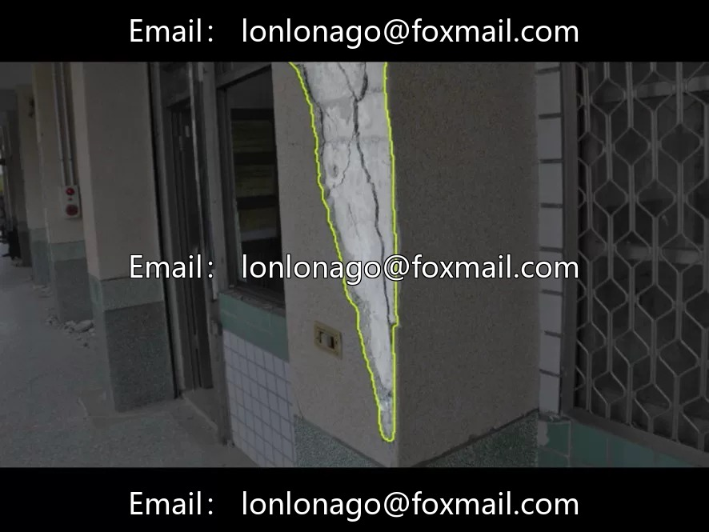
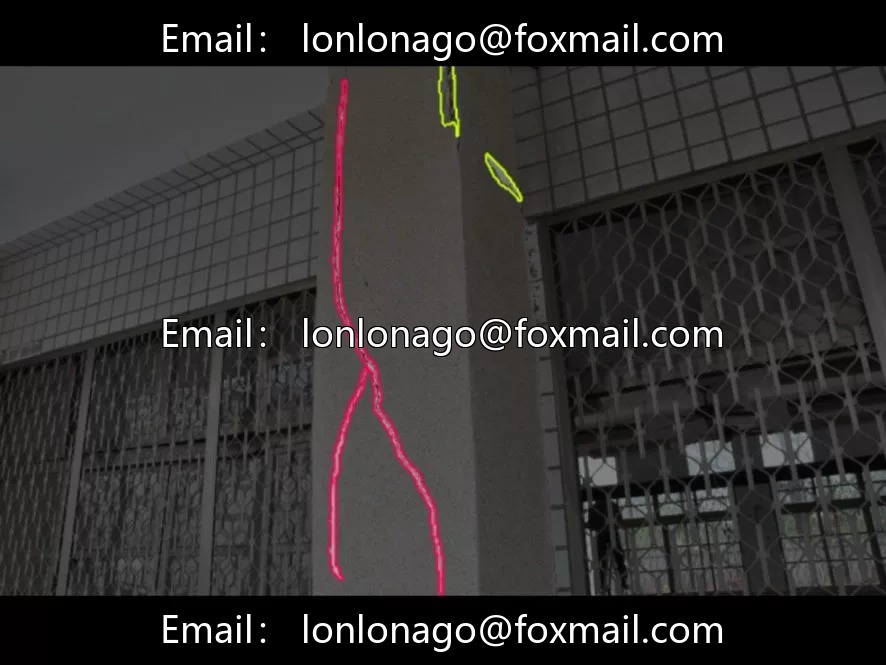
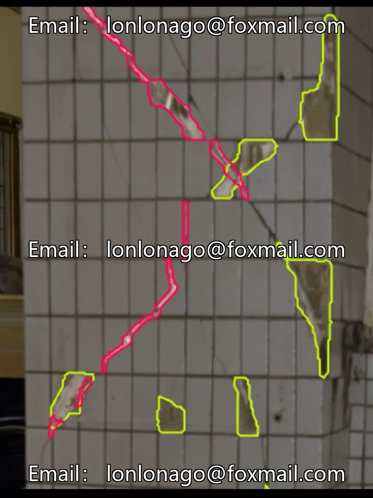
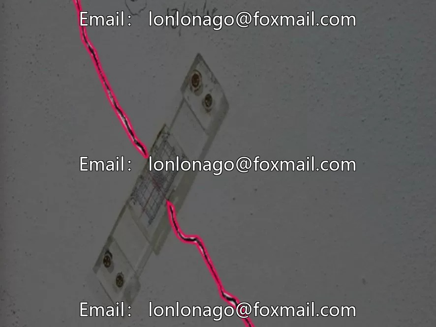

# Building Defect Detection Dataset | 3000 images, 3 categories, structural health monitoring

## Body

Building Defect Detection Dataset | 3000 images, 3 categories, structural health monitoring

3000 images in YOLO format, categorized into three types of building damage: cracks, exposed reinforcement, and delamination. It has strong generalization ability in different lighting, shooting angles and damage degrees. The three core types of apparent damage in the health monitoring of building structures

Category definitions are clear: cracking is a manifestation of stress concentration, tensile failure is the failure of the protective layer (which will subsequently rust), and peeling is a severe degradation of the protective layer. The severity of three types of damage escalates progressively in engineering, which can support the grading diagnosis of damage. YOLO format annotation, directly connect to mainstream framework training.

Application scenarios: Bridge and tunnel inspection, building exterior inspection, smart construction site safety assessment. Compared to the "UAV cement pavement defect inspection" and "road crack detection" previously posted, this is more oriented towards building/bridge structures, with the service object expanding from road maintenance to building operations.

Industrial Ground Implementation Value: Human climbing detection is dangerous and inefficient. Drones/robots combined with AI vision can significantly improve the coverage and frequency of inspections. Standardized testing procedures can be conducted in conjunction with operational parameters (flight altitude, camera tilt angle).

In a scale of 3000, it's average but doesn't specify the distribution across various categories. During training, ensure that the classes are balanced. It is recommended to split the training, validation, and test sets at an 8:1:1 ratio.

Virtual materials, once sold, are non-refundable.
Interested friends, click "I want" to proceed.

## Images

## Payment

Here is a pay link on Stripe ( https://buy.stripe.com/3cs8yP7sY87d0vu9AB ). Please contact me lonlonago@foxmail.com after funding $89, and I will send you a complete data files , thank you!

